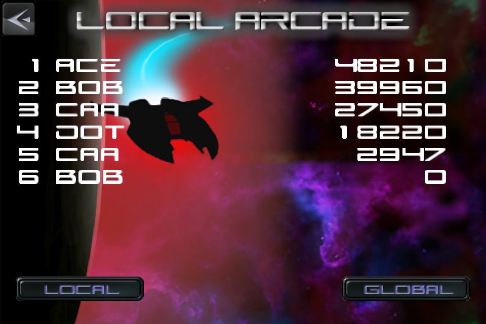
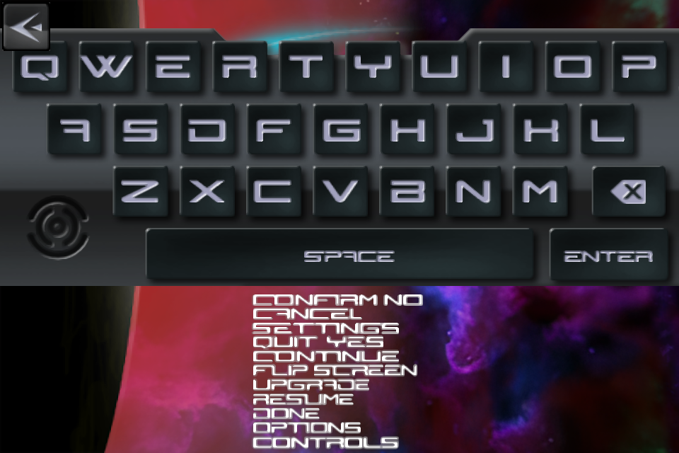

# Meteor Blitz — faithful port

A source-faithful port of Alley Labs' *Meteor Blitz* (iOS, 2009), rebuilt from the original 1.4 IPA. The game logic is translated from the decompiled ARMv6 binary; terrain, UI art, music and SFX are decoded from the original app. Rust + macroquad, one codebase for macOS, Windows and the web (WASM).

| | |
|---|---|
|  |  |
|  |  |
|  |  |

## Status

Playable end to end:

- 30 arcade stages (6 worlds × 5) and survival mode, with the original wave tables, stage clear, unlock progression and boss.
- Every enemy kind from the binary: rocks, depots, mines, shy guys, snakes, arrows, towers, seekers, lobbers and the boss.
- Cannon, fire and laser weapons, gravity gun, bombs, boost, rings, multiplier, power-ups and the upgrade shop.
- Menus and the pause/controls/upgrade/clear/game-over popups, ported from `PausePopup`; settings persist across launches; local high-score tables with name entry; HELP/tutorial captions and in-game hints.
- Keyboard/mouse and game controller input (Xbox pads on macOS through GameController and on Windows through XInput). The web build has no controller backend yet.
- Native-resolution rendering: the canvas renders at the window's fitted resolution with a 1:1 blit, and the pixel font uses nearest filtering. The original 480×320 framebuffer stays available via `MB_RENDER_SCALE=1` for emulator comparisons.
- HD art on desktop: 4x sprites, UI and font atlas, and 2x terrain textures, generated from the originals by `tools/upscale4x.py` (xBR for pixel art, Real-ESRGAN for the terrain). `MB_HD=0` selects the untouched originals, which is what the emulator-frame comparisons use; the web build stays on the originals.

Verified against emulator frames: the main-menu buttons are pixel-exact, and the pause panel's bands, rules, button nine-slice and slider knob match the decompiled drawing and the emulator pause frame; the popup's labels were measured against that frame (whole-frame diff 13.1). `cargo test` covers the boss patterns, gravity gun, ground scroll, settings, scores, tutorial gates and stick menu navigation.

Known approximations:

- The 3D planet backdrop uses the decompiled curved mesh and the original textures; the menu's texture axes are matched to the emulator frame, but the play-plane backdrop still differs in scroll phase and brightness.
- HD art is a generated approximation, not the original art: xBR smooths the pixel sprites/UI and the ESRGAN terrain is reinterpreted. The emulator-frame comparisons therefore run with `MB_HD=0` (originals); with HD on, the main-menu frame diff rises from 7.5 to 8.3.
- Pause button labels use the original `ngage` glyphs at the measured 0.54 scale with linear filtering (the engine rasterised labels into low-resolution textures), rather than the engine's per-label atlas, so glyph shapes still differ slightly.
- The Global high-score tab reports that the leaderboard is offline, because the original Game Center server is gone.

## Build

```bash
cargo run --release
```

The HD art set is committed under `assets/4x/`; `cargo run` picks it up on desktop. To regenerate it (needs `ffmpeg`; the Real-ESRGAN ncnn binary is optional and falls back to Lanczos):

```bash
python3 tools/upscale4x.py --only all
```

macOS app bundle (GameController routes controller input to app bundles):

```bash
bash tools/make-app.sh
open target/MeteorBlitz.app
```

Web build:

```bash
bash tools/build-web.sh
python3 -m http.server 8765
# then open http://localhost:8765/web.html
```

Windows: build with the MSVC toolchain; the controller backend uses XInput (see `AGENTS.md` for the Windows build notes).

## Controls

| Action | Keyboard / mouse | Controller |
| --- | --- | --- |
| Move | WASD | left stick |
| Aim / fire | mouse + left button | right stick, or RT |
| Boost | Space (or double-tap movement) | A or LB |
| Bomb | right mouse button, or B | B or RB |
| Switch weapon | Q or mouse wheel | X or Y |
| Gravity gun | E, or double-click while firing | LT |
| Pause / leave stage | Esc | Start or View |
| Menus | arrows/WASD, Enter, Esc | D-pad or left stick, A, B |

Settings and local scores live in `settings.txt` and `scores.txt` next to the executable.

## Provenance

- `original/Meteor_Blitz_1.4_ios_2.1.ipa` — the archived iOS 1.4 release (iOS 2.1 minimum), from the Internet Archive.
- `original/app/` — the extracted `.app` bundle, untouched.
- `original/textures/`, `original/audio/` — decoded PVRTC textures and WAV audio.
- `original/screenshots/emu/` — touchHLE emulator frames used as ground truth for rendering comparisons.

`original/` is read-only source material; derived assets live in `assets/` and are regenerated by scripts in `tools/`.

## Layout

- `src/` — the port: game screen, enemies, weapons, HUD, menus, pause popups, scores, controller input.
- `assets/` — decoded UI, terrain, sprites and audio used at runtime; `assets/4x/` holds the generated HD copies.
- `tools/` — asset decoders, the web build, the macOS app wrapper and the emulator-frame comparison tool.
- `docs/port-plan.md`, `AGENTS.md`, `worklog/` — plan, ground rules/resume status, and the development log.

The original game and assets are © Alley Labs. This is a fan port of the 2009 release.
