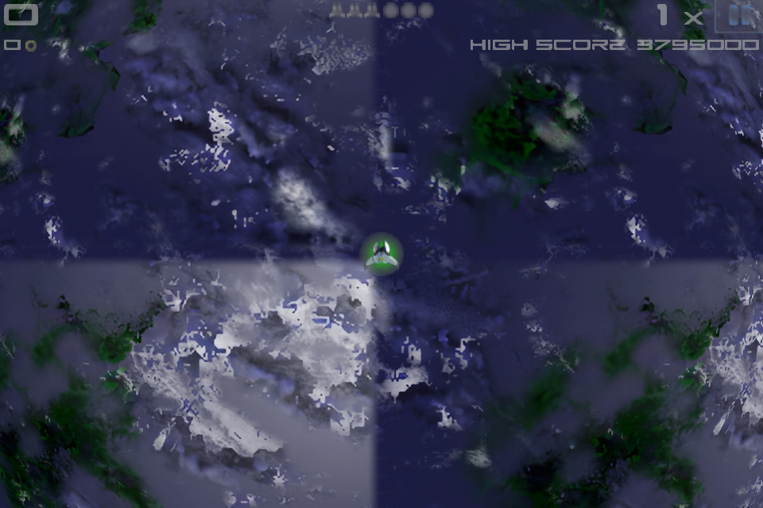
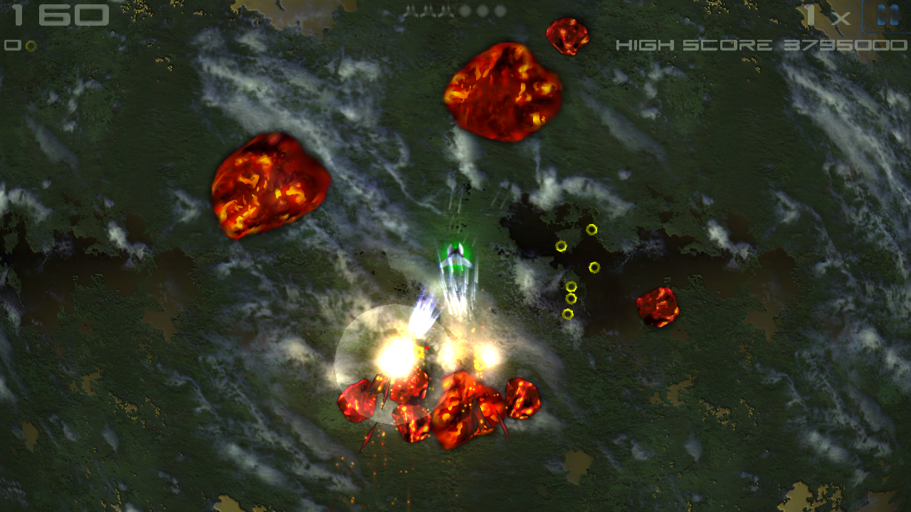
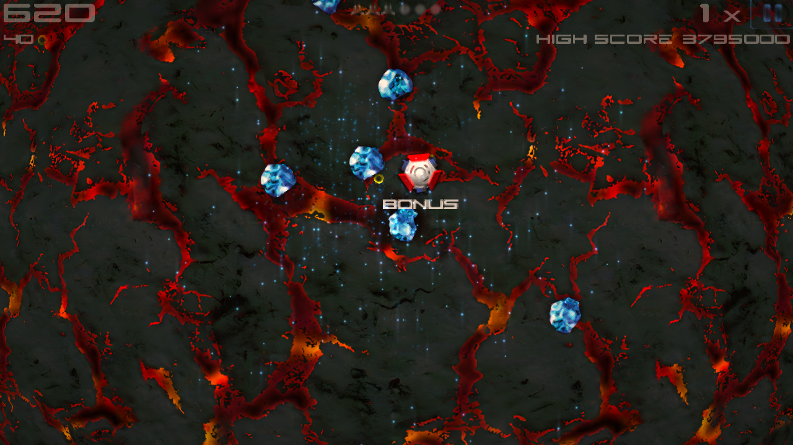
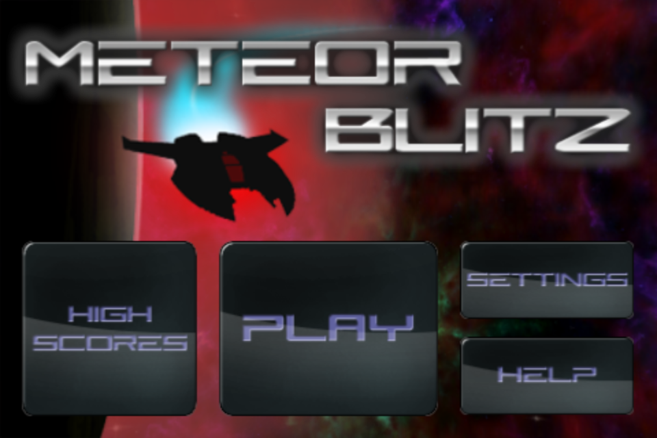
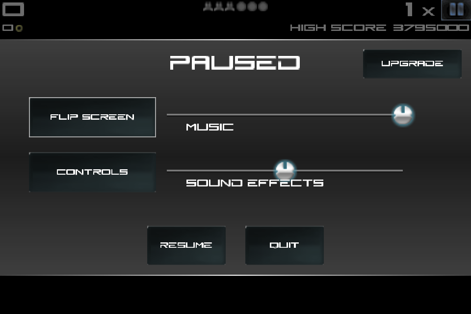
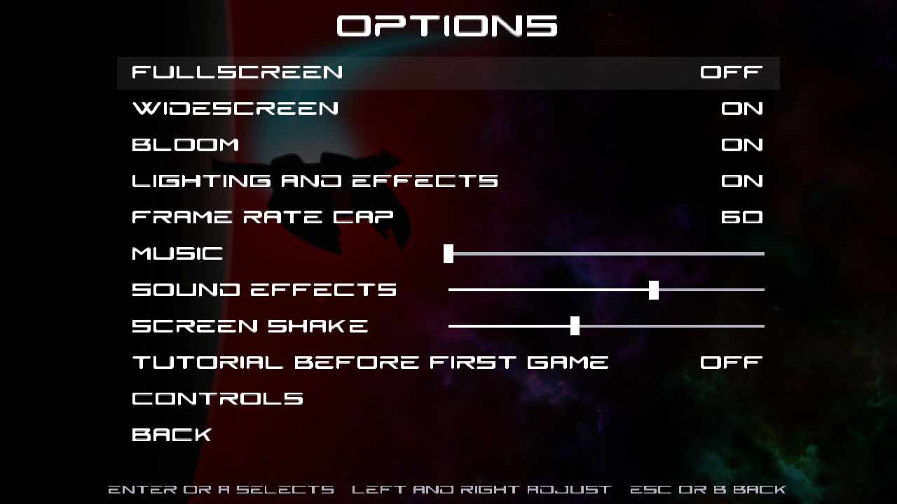
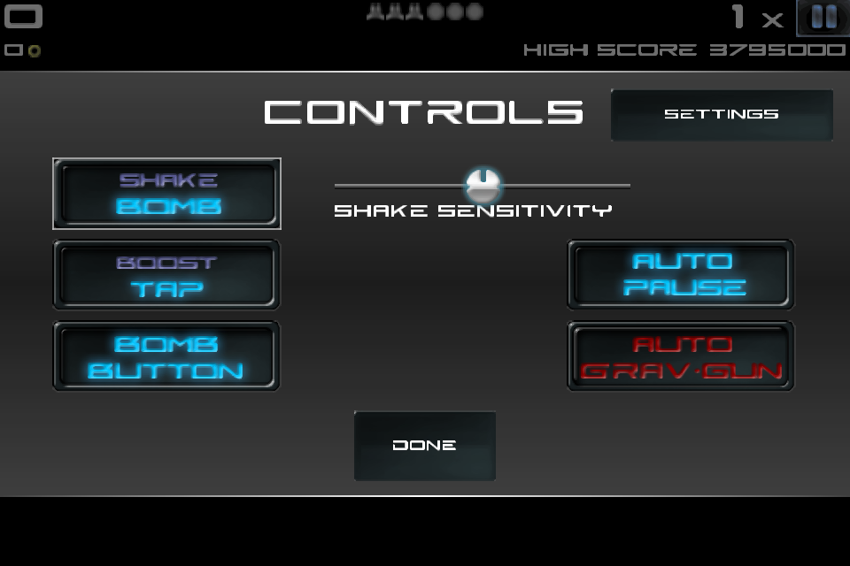
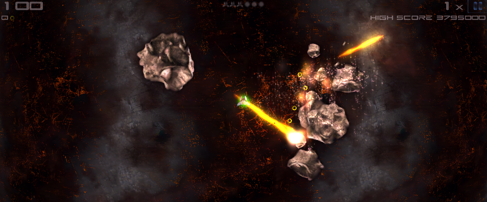

# Meteor Blitz — a modern port

A love letter to Alley Labs' *Meteor Blitz* (iOS, 2009), given away freely and remade in Rust through AI-assisted reverse engineering. The game logic, tuning, waves and bosses are translated from the decompiled ARMv6 binary of the original 1.4 release, and the art, music and sound come from its app bundle. On top of that faithful core, the presentation is rebuilt for today's machines: widescreen, high refresh rates, dynamic lighting, post-processing and rebindable controls. One Rust + macroquad codebase runs on macOS, Windows and the web (WASM).



| | |
|---|---|
|  |  |
|  |  |
|  |  |



## What's new

- **Widescreen and ultrawide.** The view follows the window from 3:2 up to 21:9. You see more of the playfield at the original scale; the HUD pins to the screen edges and menus stay centred. The window resizes freely, and F11 or Alt+Enter toggles fullscreen.
- **120 and 144 Hz.** The simulation still runs at the original's 60 Hz, and frames in between are interpolated, so motion stays smooth at 120 or 144 fps (Options > Frame rate cap).
- **Lighting.** Explosions, shots and the ship light the planet. The terrain has relief from generated normal maps, and nearby rocks and enemies pick up the light.
- **Glow, shockwaves and colour.** Bloom comes from what emits light (flames, lasers, sparks, explosions), never from bright clouds or the HUD. Bombs, boss deaths and big explosions send out shockwaves that bend the screen, and each world has its own colour grade.
- **Effects.** Round, glowing particles replace the original square points. Explosions leave scorch marks that fade. The ship has an engine trail, boost speed lines and a shield glow, and fast shots and enemies thrown by the gravity gun leave streaks.
- **HD art.** 4x sprites, UI and font, and 2x terrain, generated from the originals (`tools/upscale4x.py`).
- **Options screen** (the SETTINGS button): fullscreen, widescreen, bloom, lighting and effects, frame-rate cap, audio, screen shake, and the tutorial.
- **Rebindable controls** (HELP, or Options > Controls): every action has a keyboard/mouse binding and a controller binding, saved to `controls.txt`.
- **Tutorial.** The original's 27-step tutorial is ported. It is optional: switch on "Tutorial before first game" in Options.
- **Quality of life.** Settings and local high scores persist, and a run that makes the table asks for a name. Ring pickups no longer stack into one very loud sound.

Lighting and effects, bloom and widescreen can each be switched off in Options for a look closer to the original.

## The game

Everything from the original is in:

- 30 arcade stages (6 worlds × 5) and survival mode, with the original wave tables, stage clears, unlock progression and boss.
- Every enemy kind from the binary: rocks, depots, mines, shy guys, snakes, arrows, towers, seekers, lobbers and the boss.
- Cannon, fire and laser weapons, the gravity gun, bombs, boost, rings, the multiplier, power-ups and the upgrade shop.
- The pause, controls, upgrade, clear and game-over popups, ported from the original `PausePopup`.

The Global high-score tab reports that the leaderboard is offline, because the original Game Center server is gone.

## Build

```bash
cargo run --release
```

The HD art set is committed under `assets/4x/`; `cargo run` picks it up on desktop. To regenerate it (needs `ffmpeg`; the Real-ESRGAN ncnn binary is optional and falls back to Lanczos), and the terrain normal maps:

```bash
python3 tools/upscale4x.py --only all
python3 tools/normalmaps.py
```

Release packages (self-contained: the game data travels with the executable; saves go to `~/Library/Application Support/Meteor Blitz` or `%APPDATA%\Meteor Blitz`):

```bash
bash tools/package-macos.sh
```

That builds a universal (Apple Silicon + Intel) `dist/Meteor Blitz.app` and `dist/MeteorBlitz-<version>-macos.dmg`. `tools/make-app.sh` builds the same app for this Mac only (GameController routes controller input to app bundles). On Windows, `tools\package-windows.ps1` builds `dist\MeteorBlitz-<version>-windows.zip`.

Web build:

```bash
bash tools/build-web.sh
python3 -m http.server 8765
# then open http://localhost:8765/web.html
```

To check that the wasm bundle actually renders, without a browser window (needs Node 22+ and Chrome):

```bash
node tools/web_screenshot.mjs http://127.0.0.1:8765/web.html /tmp/web.png 20000 1280 720
```

Windows: build with the MSVC toolchain; the controller backend uses XInput (see `AGENTS.md` for the Windows build notes).

## Controls

Defaults; everything except the sticks, Esc and menu navigation can be rebound on the Controls page.

| Action | Keyboard / mouse | Controller |
| --- | --- | --- |
| Move | WASD | left stick |
| Aim / fire | mouse + left button | right stick, or RT |
| Boost | Space | A or LB |
| Bomb | right mouse button, or B | B or RB |
| Switch weapon | Q or mouse wheel | X or Y |
| Gravity gun | E, or double-click while firing | LT |
| Pause | Esc | Start or View |
| Fullscreen | F11 or Alt+Enter | |
| Menus | arrows/WASD, Enter, Esc | D-pad or left stick, A, B |

Settings, bindings and local scores live in `settings.txt`, `controls.txt` and `scores.txt` next to the executable.

## Fidelity

The original look is still there underneath. `MB_WIDE=0 MB_HD=0 MB_RENDER_SCALE=1 MB_BLOOM=0 MB_FX_OFF=1` renders the original 480×320 framebuffer with the original art. Against touchHLE emulator frames, the main-menu buttons are pixel-exact, and the pause panel matches the decompiled drawing. `cargo test` covers the boss patterns, gravity gun, ground scroll, frame interpolation, the camera at wide aspects, settings, bindings, scores, the tutorial and menu navigation.

## Provenance

- `original/Meteor_Blitz_1.4_ios_2.1.ipa` — the archived iOS 1.4 release (iOS 2.1 minimum), from the Internet Archive.
- `original/app/` — the extracted `.app` bundle, untouched.
- `original/textures/`, `original/audio/` — decoded PVRTC textures and WAV audio.
- `original/screenshots/emu/` — touchHLE emulator frames used as ground truth for rendering comparisons.

`original/` is read-only source material; derived assets live in `assets/` and are regenerated by scripts in `tools/`.

## Layout

- `src/` — the port: game screen, enemies, weapons, HUD, menus, pause popups, options and bindings, scores, controller input, rendering.
- `assets/` — decoded UI, terrain, sprites and audio used at runtime; `assets/4x/` holds the generated HD copies, `assets/normals/` the terrain normal maps.
- `tools/` — asset decoders, the upscaler and normal-map generator, the web build, the macOS app wrapper and the emulator-frame comparison tool.
- `docs/port-plan.md`, `AGENTS.md`, `worklog/` — plan, ground rules/resume status, and the development log.

The original game and assets are © Alley Labs. This is a free, non-commercial fan port of the 2009 release.
